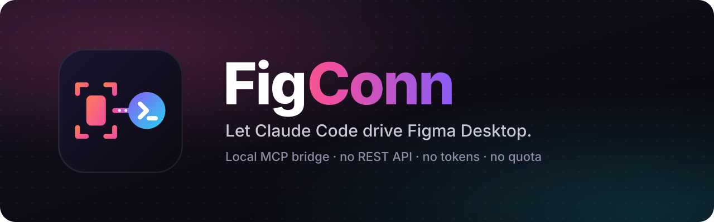
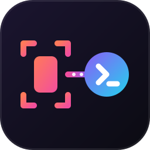

<p align="center">
  
</p>

<p align="center">
  <a href="https://modelcontextprotocol.io"></a>
  
  
  
</p>

<p align="center">
  <b>FigConn</b> connects Claude Code (or any MCP client) straight to <b>Figma Desktop</b> through a local plugin.<br>
  No REST API, no personal access tokens, no rate limits. If you can do it with the Plugin API, Claude can do it.
</p>

---

## Why FigConn?

|  | Figma REST API based MCPs | **FigConn** |
|---|---|---|
| Rate limits / quota | Yes | **None.** Everything runs locally |
| Write access (create, edit, delete) | Very limited | **Full Plugin API** |
| Variables, modes, styles, components | Read-only, mostly | **Create, update, bind** |
| Token setup | Personal access token | **None** |
| Works on unsaved / local changes | No | **Yes**, it reads the live document |

## How it works

```
┌──────────────┐  stdio   ┌──────────────────────┐  ws://localhost:3911-3920  ┌──────────────────────┐
│  Claude Code │ ───────► │  FigConn MCP server  │ ◄────────────────────────► │  FigConn plugin      │
│  (any MCP    │          │  server/index.js     │      loopback only         │  in Figma Desktop    │
│   client)    │ ◄─────── │  + server/tools/*.js │                            │  (Plugin API)        │
└──────────────┘          └──────────────────────┘                            └──────────────────────┘
```

The MCP server opens a WebSocket on the first free port between 3911 and 3920. The plugin window scans that range and connects to every server it finds, so **several Claude sessions and several Figma files can be connected at once**.

## Quick start

**1. Install**

```bash
git clone https://github.com/fairuzatikahhh/FigConn.git
cd FigConn
npm install
```

**2. Register the MCP server** (see [other clients](#register-in-other-mcp-clients) below)

```bash
claude mcp add figconn -s user -- node "$(pwd)/server/index.js"
```

**3. Import the plugin into Figma Desktop**

Figma Desktop → **Plugins → Development → Import plugin from manifest…** → pick `plugin/manifest.json`.

**4. Connect**

Open any Figma file → **Plugins → Development → FigConn**. Keep the small window open until it shows **● Connected**.

Then just ask:

> *"Check FigConn status, then build a Button component with Primary / Secondary / Ghost variants in sizes S, M and L, bound to my color variables."*

## Register in other MCP clients

<details>
<summary><b>Claude Desktop</b></summary>

`~/Library/Application Support/Claude/claude_desktop_config.json` (macOS) or `%APPDATA%\Claude\claude_desktop_config.json` (Windows):

```json
{
  "mcpServers": {
    "figconn": {
      "command": "node",
      "args": ["/absolute/path/to/FigConn/server/index.js"]
    }
  }
}
```
</details>

<details>
<summary><b>Cursor</b></summary>

`~/.cursor/mcp.json` (global) or `.cursor/mcp.json` (per project):

```json
{
  "mcpServers": {
    "figconn": {
      "command": "node",
      "args": ["/absolute/path/to/FigConn/server/index.js"]
    }
  }
}
```
</details>

<details>
<summary><b>VS Code (Copilot agent mode)</b></summary>

`.vscode/mcp.json`:

```json
{
  "servers": {
    "figconn": {
      "type": "stdio",
      "command": "node",
      "args": ["/absolute/path/to/FigConn/server/index.js"]
    }
  }
}
```
</details>

<details>
<summary><b>Run without cloning the server (npx)</b></summary>

The server can run straight from GitHub. You still need the `plugin/` folder locally to import into Figma.

```bash
claude mcp add figconn -s user -- npx -y github:fairuzatikahhh/FigConn
```
</details>

## Tools

62 tools in 9 groups. Anything not covered can be done with **`execute`**, which runs arbitrary Plugin API code.

<details open>
<summary><b>🔌 Connection & escape hatch</b></summary>

| Tool | What it does |
|---|---|
| `status` | Port and connected files (name, page, selection) |
| `execute` | Run any async Plugin API code, with helpers (`h.hex`, `h.node`, `h.ser`, `h.findVariable`…) |
</details>

<details open>
<summary><b>🔍 Read & inspect</b></summary>

| Tool | What it does |
|---|---|
| `get_document` | Pages and top-level nodes |
| `get_selection` / `get_node` | Serialised node tree up to `depth` |
| `get_layout_tree` | Flat list with absolute bounds, sizing, constraints |
| `get_screenshot` | PNG / JPG image or SVG markup of a node, with a size guard |
| `save_screenshots` | Batch export PNG / JPG / SVG / PDF to disk |
| `set_selection` / `scroll_into_view` | Select and zoom, or just move the viewport |
</details>

<details>
<summary><b>✏️ Create</b></summary>

| Tool | What it does |
|---|---|
| `create_frame` | Frame with optional auto layout |
| `create_text` | Text node, fonts loaded automatically |
| `create_shape` | Rectangle, ellipse, line, polygon, star |
| `create_svg` | Editable vectors from SVG markup or file, optional flatten |
| `create_image` | Image from a local file, URL or data URI |
| `create_page` / `create_section` / `fit_section` | Pages and sections, sections that wrap their content |
</details>

<details>
<summary><b>🎛️ Edit & style</b></summary>

| Tool | What it does |
|---|---|
| `set_properties` | Set any node property (`fills: "#hex"`, `characters`, `width`…) |
| `set_auto_layout` / `set_layout_child` | Direction, gap, padding, alignment, wrap; FILL / HUG / FIXED, absolute |
| `set_effects` | Drop / inner shadows, layer / background blur |
| `set_gradient` | Linear / radial / angular / diamond with an `angle` |
| `set_stroke` | Color, weight per side, align, dashes, caps |
| `set_constraints` | Responsive constraints |
| `delete_nodes` | Delete nodes |
</details>

<details>
<summary><b>🧱 Structure & arrange</b></summary>

| Tool | What it does |
|---|---|
| `duplicate_nodes` | Clone with offset, repeat N times, or into another parent |
| `group_nodes` / `ungroup_node` | Group (or wrap in a frame) and unwrap, keeping positions |
| `reparent_nodes` / `reorder_nodes` | Move to another parent; bring to front / send back |
| `place_relative` | Put a node right / left / above / below another |
| `align_nodes` / `distribute_nodes` | Align edges or centers; equal spacing or fixed gap |
| `arrange_grid` / `align_to_grid` | Lay out in a grid (great for variant sheets); snap to grid |
</details>

<details>
<summary><b>🎨 Variables (design tokens)</b></summary>

| Tool | What it does |
|---|---|
| `get_variables` | Collections, modes, values per mode |
| `create_variable_collection` | Collection with modes (Light / Dark…) |
| `create_variables` | Create or update in bulk, values per mode, aliases, scopes |
| `bind_variable` | Bind to fill, stroke, padding, radius, gap, size, typography… |
| `set_variable_mode` | Switch a frame to a mode |
| `list_library_variables` / `import_library_variable` | Use variables from team libraries |
</details>

<details>
<summary><b>🖌️ Styles</b></summary>

| Tool | What it does |
|---|---|
| `get_styles` | Paint, text, effect and grid styles |
| `create_paint_style` | From a hex color or bound to a color variable |
| `create_text_style` | Font, size, line height, letter spacing, case |
| `create_effect_style` | Shadow styles |
| `apply_style` | Apply any style by name or id |
</details>

<details>
<summary><b>🧩 Components</b></summary>

| Tool | What it does |
|---|---|
| `get_components` | Components and sets with keys and properties |
| `create_component` / `combine_as_variants` | Make components and variant sets |
| `add_component_property` | Boolean / text / instance swap / variant properties |
| `create_instance` / `set_instance_properties` | Local or library instances, set variant values |
</details>

<details>
<summary><b>▶️ Prototyping & 🟨 FigJam</b></summary>

| Tool | What it does |
|---|---|
| `get_prototype_connections` | All interactions under a node, destinations resolved |
| `trace_prototype_flow` | Walk the flow screen by screen from a start frame |
| `set_reaction` / `set_flow_starting_point` | Add interactions and flow starts |
| `create_sticky` / `create_shape_with_text` | FigJam stickies and labelled shapes |
| `create_connector` / `create_table` | FigJam connectors and tables |
</details>

## Example prompts

- *"Read my selected frame and rebuild it with auto layout, binding all colors to the `color/*` variables."*
- *"Create a `Spacing` collection with 4, 8, 12, 16, 24, 32 and bind the card's padding to `space/16`."*
- *"Make a Light / Dark `Theme` collection from these hex values, then switch the Settings screen to Dark."*
- *"Export every frame on this page as 2× PNG into `./exports`."*
- *"Trace the prototype flow from the Login screen and list any dead ends."*

## Multiple files and sessions

- Every tool takes an optional `file` parameter (file name or id). Without it, FigConn uses the file whose plugin window was active most recently.
- Up to 10 MCP servers (Claude sessions) can run at once, one per port in 3911–3920. The plugin connects to all of them.

## Security

- The server listens on **loopback only** (`127.0.0.1` / `::1`).
- Connections with a browser `Origin` header other than `null` (the plugin iframe) are rejected, so web pages can't talk to it.
- The plugin's `networkAccess` only allows the local ports.
- `execute` runs arbitrary code in your Figma file. Only connect clients you trust.

## Development

```
server/index.js          MCP server + WebSocket bridge + core tools
server/tools/*.js        extra tool modules, auto-loaded (export register(ctx))
plugin/src/00-core.js    plugin helpers + core handlers
plugin/src/NN-*.js       handler modules (H.tool_name = async fn)
plugin/src/99-loop.js    message loop
plugin/code.js           GENERATED: npm run build
```

```bash
npm run build   # concatenate plugin/src → plugin/code.js
npm run check   # build + syntax check everything
```

- After changing `server/`, restart your MCP client.
- After changing `plugin/src/`, run `npm run build` and re-run the plugin in Figma.
- Plugin code is plain ES2017 (no optional chaining or object spread) for the Figma sandbox.

## Troubleshooting

| Symptom | Fix |
|---|---|
| `No Figma file connected` | Open the plugin in Figma (Plugins → Development → FigConn) and wait for **Connected** |
| Plugin stuck on *Disconnected* | Make sure your MCP client is running; `status` shows which port the server took |
| `Timed out waiting for Figma` | The plugin window was closed, or the operation is large. Re-open it, or pass a bigger `timeoutMs` to `execute` |
| New tools don't show up | Restart the MCP client; re-run the plugin after `npm run build` |
| Only 1 mode per collection | That's a Figma plan limit (Starter), not FigConn |

---

<p align="center">
  <br>
  <sub>Built for designers who'd rather describe than click.</sub>
</p>
